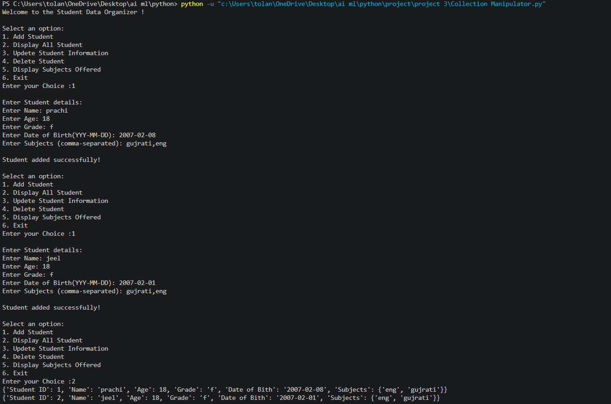
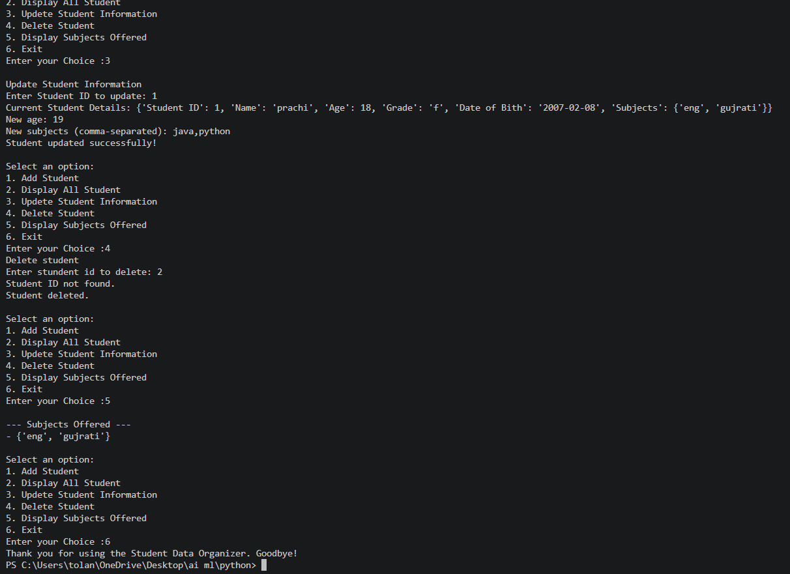

# Student Data Organizer

This is a simple Python project to manage student records. It allows users to add, display, update, and delete student information.

## Output 1 – Add Student

## Output 2 – Display Student

